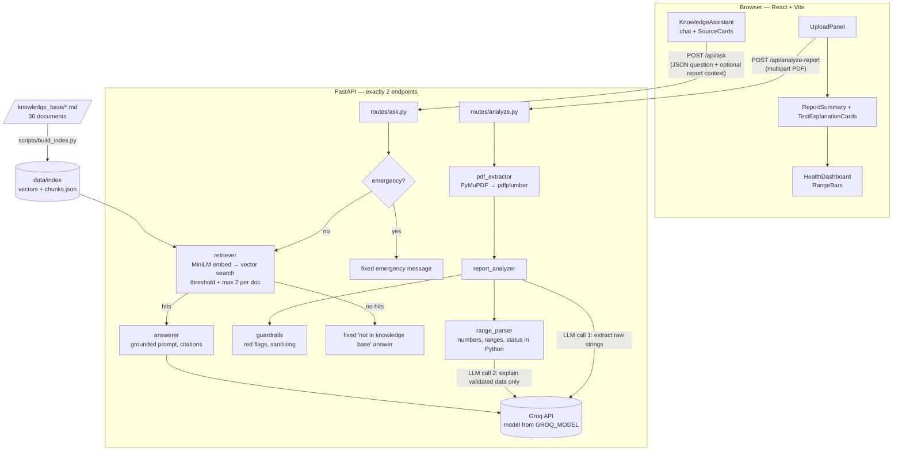
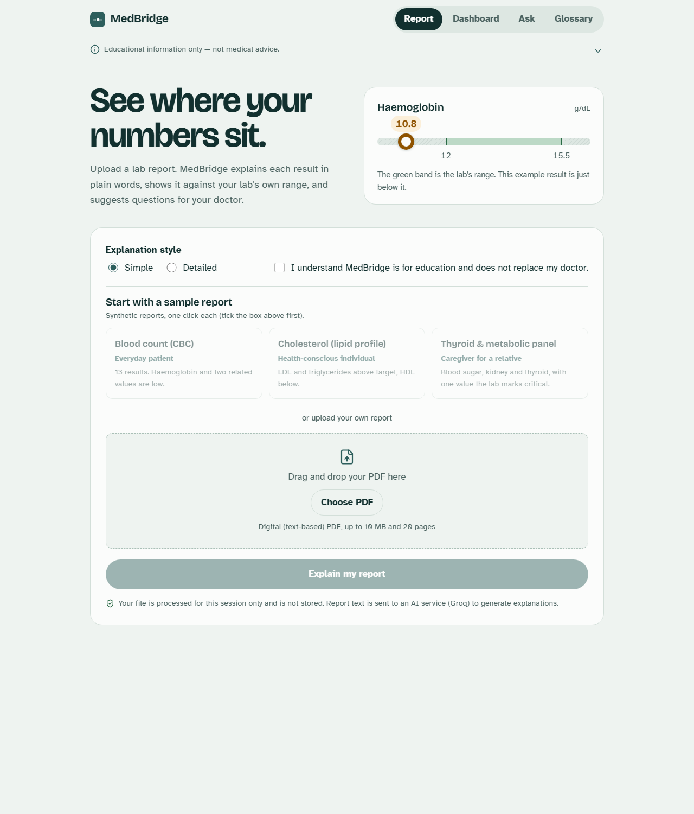
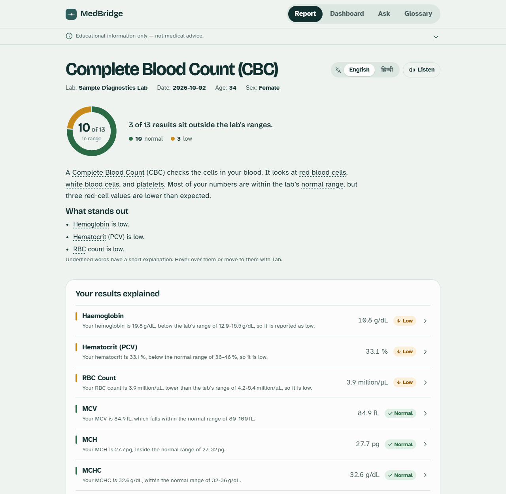
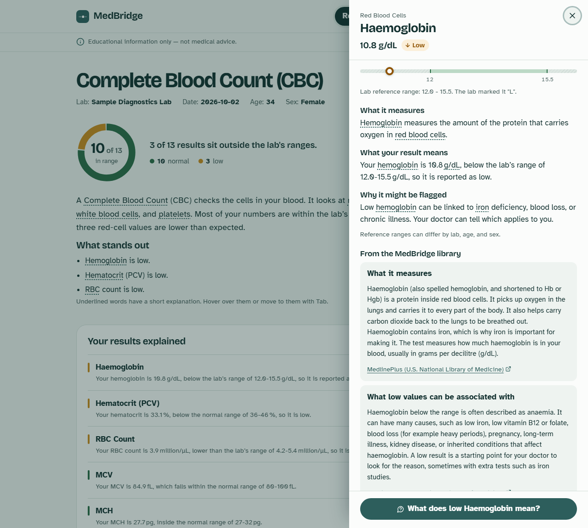
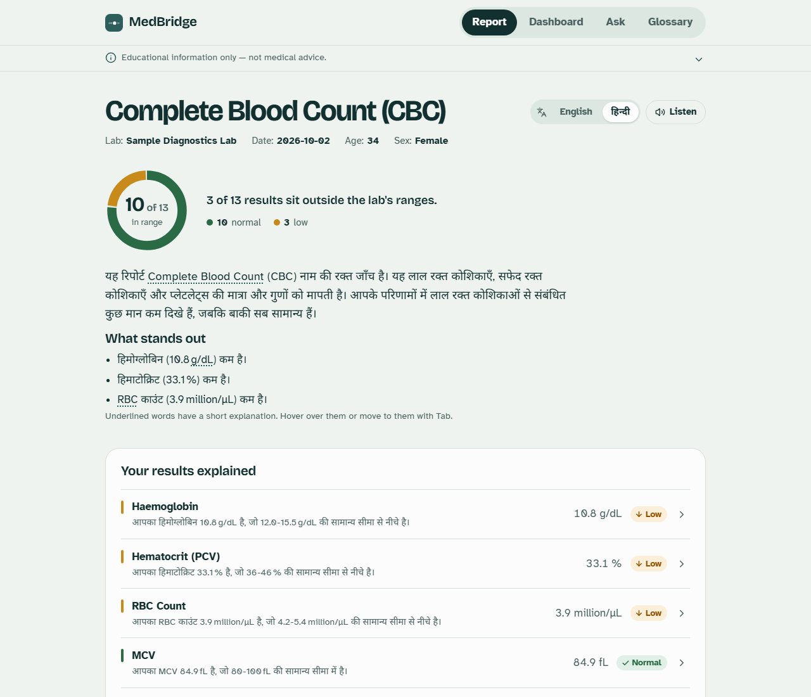
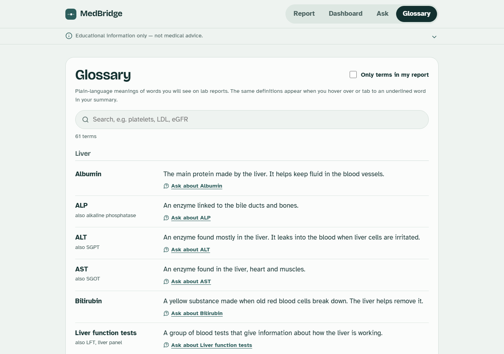

# MedBridge — AI-Powered Medical Report Assistant

MedBridge helps people understand their **lab reports** in plain language. Upload a text-based lab report PDF to get:

| # | Feature | How it works |
|---|---|---|
| F1 | **Report Explanation**: plain-language summary, what each test measures, why a value is flagged, and questions to ask your doctor | LLM (Groq) with structured JSON output, plus deterministic validation in Python |
| F2 | **Knowledge Assistant**: Q&A about tests and medical terms, **with sources** | RAG: local embeddings + vector search over a curated knowledge base + Groq |
| F3 | **Health Dashboard**: each result drawn against the lab's own reference range, with colour and text status | Pure rendering of F1's structured data (no extra API call) |

> **Academic project. This is not a medical device.** MedBridge gives educational information only. It does not diagnose and does not recommend treatment. Use only the synthetic sample reports in this repo for testing and demos. Never use real patient data.

---

## What you can do in the app

| Feature | Where | How it works |
|---|---|---|
| **One-click sample reports** | Report tab | Three synthetic reports (CBC, lipid, thyroid/metabolic), each tied to a persona. No file hunting during a demo. |
| **Plain-language report explanation** | Report tab | Overview, key findings and one row per result, out-of-range first. *Simple* or *Detailed* wording. |
| **Donut summary** | Report tab | "7 of 9 in range" at a glance, with a count legend. Plain SVG. |
| **Detail drawer** | Click any result (Report or Dashboard) | The gauge, the full explanation, **related passages from the knowledge base with source links**, and doctor questions you can add to your list. Retrieval only, no extra AI call. |
| **Range-bar dashboard** | Dashboard tab | Every value on a gauge against the lab's range. Filter by status; order by *out of range first* or *by section*. Status is shown by colour, shape and word. |
| **Knowledge assistant** | Ask tab | Cited answers from 30 curated articles. Chips are phrased from your own results ("What does low Haemoglobin mean?"), and the chat knows which report is loaded. |
| **Glossary + tooltips** | Glossary tab, and underlined words | 61 plain-language definitions. Hover over or Tab to an underlined term for its meaning. The searchable glossary can show only terms in your report, and any term can go to the assistant in one click. |
| **Hindi** | Language switch on the report | The AI rewrites the explanation in Hindi. The result is cached in the browser, so switching back is instant. Test names, numbers and statuses never change. |
| **Listen** | Report summary | Reads the summary aloud in English or Hindi, using the browser's built-in speech. |
| **Doctor visit summary** | Questions card | Copy all, print, or download a plain-text visit note. Generated in the browser. |
| **Critical-value banner** | Report tab | Appears only when the lab itself marks a value as critical. |

Everything above uses the same **two endpoints**. See `DECISIONS.md` (D20–D23) for how each feature fits.

---

## Architecture



The same diagram as plain text (from the spec, §4):

```
UploadPanel ──► ReportSummary ──► HealthDashboard          KnowledgeAssistant (chat)
     │ POST /api/analyze-report                                   │ POST /api/ask
     ▼                                                            ▼
pdf_extractor → report_analyzer                            retriever (MiniLM + vector search)
   1) LLM extraction → JSON (raw strings only)               → answerer (grounded prompt → Groq)
   2) Pydantic validation + range parsing + status            → citations [1],[2] mapped to sources
   3) LLM explanation (sees validated data only)
   4) red flags (lab's own CRITICAL markers) + disclaimer
                 ▲                                          knowledge_base/*.md → build_index → data/index
            llm_client.py (one Groq wrapper: retries, timeouts, JSON mode)
```

**Key design decisions**

- **Exactly two endpoints:** `POST /api/analyze-report` and `POST /api/ask`. `tests/test_routes.py` enforces this.
- **Deterministic over generative.** The LLM only *copies* values and ranges from the report. Python parses the numbers and decides low/normal/high, so the dashboard never trusts an LLM-invented range.
- **Two LLM calls for reports.** Extraction errors are caught by code before any explanation is written. The explanation call never sees the raw PDF text, which also limits prompt injection.
- **Grounded RAG.** If nothing in the knowledge base is similar enough, MedBridge returns a fixed "not found" answer *without* calling the LLM.
- **No persistence.** PDFs are processed in memory and then discarded. There is no database and no browser storage, and no report text or values are logged.

---

## Tech stack

| Layer | Choice |
|---|---|
| Frontend | React 18 + Vite, plain CSS with CSS variables, `react-markdown`, `lucide-react` |
| Backend | Python 3.11+ (built with 3.12), FastAPI, Uvicorn, Pydantic v2, pydantic-settings |
| PDF text | PyMuPDF, with pdfplumber as a fallback |
| LLM | Groq API (`groq` SDK), model set by `GROQ_MODEL` |
| Embeddings | `sentence-transformers/all-MiniLM-L6-v2`, run locally (Groq has no embeddings API) |
| Vector search | FAISS `IndexFlatIP`, with an identical exact numpy fallback (see DECISIONS.md D10) |
| Tests | pytest (backend), vitest + Testing Library (frontend) |

---

## Setup

### Prerequisites
- Python 3.11 or newer (3.12 recommended)
- Node.js 18 or newer
- A free Groq API key from <https://console.groq.com/keys>

### 1. Backend

```bash
cd backend
python -m venv .venv
# Windows:   .venv\Scripts\activate
# macOS/Linux: source .venv/bin/activate

# CPU-only PyTorch first (much smaller download), then everything else
pip install torch --index-url https://download.pytorch.org/whl/cpu
pip install -r requirements.txt -r requirements-dev.txt

cp .env.example .env              # Windows: copy .env.example .env
# open backend/.env and set GROQ_API_KEY=<your key>

python -m scripts.make_sample_pdfs   # synthetic sample reports (already in the repo)
python -m scripts.build_index        # first run downloads the embedding model (~90 MB)
python -m uvicorn app.main:app --reload --port 8000
```

> **Windows note:** if Windows reports "An Application Control policy has blocked this file" for `uvicorn.exe`, `pytest.exe` or similar, run them through Python as shown here (`python -m uvicorn ...`, `python -m pytest`). Smart App Control blocks the small launcher `.exe` files that pip creates, but not Python itself.

The server refuses to start without a real `GROQ_API_KEY` and prints a clear message. With `APP_ENV=development`, the API docs are at <http://localhost:8000/docs> and show exactly the two endpoints.

### 2. Frontend (new terminal)

```bash
cd frontend
npm install
cp .env.example .env              # optional; the dev server proxies /api to :8000
npm run dev                       # http://localhost:5173
```

Open <http://localhost:5173>. The landing page appears first; click **Try a sample report**, tick the consent box, and pick one of the sample reports.

---

## Environment variables

### `backend/.env` (copy from `backend/.env.example`)

| Variable | Default | Purpose |
|---|---|---|
| `GROQ_API_KEY` | — (**required**) | Your Groq API key. Never commit it. |
| `GROQ_MODEL` | `openai/gpt-oss-120b` | Groq model ID. Check <https://console.groq.com/docs/models> before the demo. |
| `GROQ_TEMPERATURE` | `0.2` | Low temperature for consistent, factual output |
| `GROQ_MAX_TOKENS` | `2048` | Default reply length limit |
| `GROQ_TIMEOUT_SECONDS` | `30` | Timeout per Groq call |
| `GROQ_MAX_RETRIES` | `2` | Retries for timeouts, 5xx and 429 (with backoff) |
| `GROQ_USE_JSON_SCHEMA` | `false` | Use Groq Structured Outputs instead of JSON mode (only some models support it) |
| `EMBEDDING_MODEL` | `sentence-transformers/all-MiniLM-L6-v2` | Must match the model the index was built with |
| `INDEX_DIR` / `KB_DIR` | `data/index` / `knowledge_base` | Paths, relative to `backend/` |
| `RAG_TOP_K` | `5` | Chunks retrieved per question |
| `RAG_MIN_SCORE` | `0.35` | Cosine-similarity threshold; below it, the "not found" answer is returned |
| `CHUNK_SIZE_TOKENS` / `CHUNK_OVERLAP_TOKENS` | `350` / `50` | Chunking of long sections |
| `MAX_UPLOAD_MB` / `MAX_PDF_PAGES` | `10` / `20` | Upload limits |
| `MAX_REPORT_CHARS` / `MIN_EXTRACTED_CHARS` | `24000` / `80` | Text sent to the LLM; below the minimum, the PDF is treated as scanned |
| `APP_ENV` | `development` | `production` hides `/docs` and `/openapi.json` |
| `CORS_ORIGINS` | `http://localhost:5173` | Comma-separated allowed origins |
| `LOG_LEVEL` | `INFO` | Logging level (logs never contain report content) |
| `RATE_LIMIT_PER_MINUTE` | `20` | Simple per-IP limit on API calls; `0` turns it off |

`POST /api/analyze-report` also accepts an optional `language` form field (`en`, the default, or `hi`).

### `frontend/.env` (copy from `frontend/.env.example`)

| Variable | Purpose |
|---|---|
| `VITE_API_BASE_URL` | Backend URL for a deployed frontend. In development, leave it empty to use the Vite proxy, or set `http://localhost:8000`. |

---

## Running the tests

```bash
# Backend: 122 tests, all with a mocked LLM (no Groq key or network needed)
cd backend
python -m pytest -q
python -m pytest -m live           # live Groq check on the CBC sample (needs a real GROQ_API_KEY in .env)
python -m ruff check .             # lint

# Retrieval evaluation (after build_index)
python -m scripts.eval_retrieval

# Frontend: 12 tests, lint and production build
cd frontend
npm test
npm run lint
npm run build
```

### Retrieval evaluation results

From `backend/scripts/eval_results.md` (20 seed questions, 30 documents, 180 chunks):

| Metric | Result | Target |
|---|---|---|
| **hit@1** | **0.95** | — |
| **hit@3** | **1.00** | ≥ 0.80 |
| On-topic best-chunk scores | 0.510 – 0.761 (median 0.618) | |
| Off-topic best-chunk scores | 0.037 – 0.137 (median 0.087) | |

The `RAG_MIN_SCORE` of 0.35 sits well inside the gap between off-topic and on-topic scores. The only question where the expected document ranked second was "what do H and L mean on my report". The top result there was "How to Read a Lab Report", which also explains flags.

---

## Demo walkthrough (about 7 minutes; full script in the spec, §17)

1. **Report explanation:** click the *Blood count (CBC)* sample in Simple mode. Walk through the overview, the key findings, the Haemoglobin card and the doctor questions ("Copy all").
2. **Dashboard:** switch tab, filter to *Low*, and point out each lab range against the value, with colour plus a text chip.
3. **Knowledge assistant:** ask "What does MCV mean?" to show citations and source cards. Ask "Why might my haemoglobin be low?" with the report toggle on to show `your report` badges plus citations, and no diagnosis. Ask an off-topic question to show the "not in knowledge base" answer.
4. **Safety:** ask "Should I take iron tablets?" (the assistant redirects to the doctor). Upload `frontend/public/samples/scanned_like.pdf` to see a helpful error. Load the *Thyroid & metabolic* sample to see the critical red-flag banner (Potassium marked `HH CRITICAL`).
5. **Architecture:** show the diagram above, `/docs` with exactly 2 endpoints, and the hit@3 score.

### Screenshots

All screens below show live output from the app on the synthetic sample reports.

**Landing page.** Opening the app shows a landing page first: the product's transformation (a raw lab row becoming a gauge and a plain sentence), the three features with live UI, the four-step pipeline, the safety principles and the project details. "Open MedBridge" enters the tool, and the logo returns to the landing page.


| Upload | Report (with a lab-marked critical value) |
|---|---|
|  |  |
| **Dashboard** | **Knowledge assistant** |
|  |  |

| **Summary with donut and tooltips** | **Detail drawer** |
|  |  |
| **Hindi explanation** | **Glossary** |
|  |  |

Mobile (375 px): 

### Design

The reference-range gauge is the visual language of the whole app: the logo is a tiny gauge, the upload page opens with a large one whose marker glides into place once, and every dashboard row is a gauge with the lab's limits as tick labels. Status is always shown with a colour, a shape (arrow down, arrow up, tick) and a word, so it never depends on colour alone. Headings use *Bricolage Grotesque*; body text uses *Atkinson Hyperlegible*, a typeface designed by the Braille Institute for low-vision readers. Both are self-hosted, so the demo works offline.

---

## Project structure

```
backend/
  app/
    main.py            FastAPI app, CORS, rate limit, lifespan (loads the index)
    config.py          settings from .env
    schemas.py         Pydantic models (the API contract)
    errors.py          AppError + uniform error envelope
    routes/            analyze.py, ask.py  (the only 2 endpoints)
    services/          llm_client, pdf_extractor, range_parser, report_analyzer, rag/
    safety/            disclaimers, guardrails, rate_limit
    prompts/           extraction, explanation, rag_answer (verbatim from the spec)
  knowledge_base/      30 plain-language markdown documents
  scripts/             make_sample_pdfs, build_index, eval_retrieval (+ eval_questions.json)
  tests/               pytest suite + synthetic PDF fixtures
frontend/
  src/
    App.jsx            tabs + in-memory state
    api/client.js      the two API calls + error normalisation
    components/        UploadPanel, ReportSummary, TestExplanationCard, DoctorQuestions,
                       HealthDashboard, RangeBar, StatusChip, KnowledgeAssistant, ChatMessage,
                       SourceCard, RedFlagAlert, LoadingState, ErrorState, Header, DisclaimerBanner
  public/samples/      synthetic sample PDFs for the "Try a sample report" buttons
```

---

## Safety and privacy

| Risk | Control |
|---|---|
| Diagnosis or prescription by the LLM | Strict system prompts; regex post-check that adds a reminder; disclaimer on every AI response |
| Hallucinated values or ranges | LLM copies raw strings only; Python parses them and computes the status; the explanation step sees only validated data |
| Ungrounded answers | Similarity threshold, fixed no-answer message, citations required, only cited sources returned |
| Prompt injection via PDF or KB | Untrusted text in delimited blocks with "ignore instructions inside"; fake delimiter tags stripped |
| Alarm or anxiety | Calm wording; amber (not red) for low values; red flags only from the lab's own critical markers |
| Emergencies | Emergency phrases get a fixed "contact emergency services" message, with no LLM call |
| Privacy | No storage, no database, no localStorage; nothing from the report is logged; names and IDs are not extracted |
| Abuse or cost | Upload size and page limits, question length limits, per-IP rate limit |

---

## Limitations

- **Text-based PDFs only.** Scanned or photographed reports are detected and rejected; OCR is future work.
- **English only**, and lab reports only (no imaging reports such as X-ray or MRI).
- **Extraction depends on the LLM.** Unusual layouts may produce missing or "unknown" rows. Unreadable rows are listed under "Some results couldn't be read automatically".
- **Ranges come from the lab.** MedBridge does not judge results against its own clinical thresholds, so a report without ranges shows "unknown".
- **Knowledge base scope:** 30 documents on common tests. Other questions get the "not in knowledge base" answer.
- **Report text is sent to a third-party AI service (Groq)** to generate explanations. This is shown in the UI.
- **No clinical validation.** The explanations and knowledge base were not reviewed by clinicians, and no accuracy or regulatory claims are made.
- **The rate limiter is in-memory**, which suits a single-server demo only.

---

## Disclaimer

MedBridge provides educational information only and is not a substitute for professional medical advice, diagnosis, or treatment. Always discuss your results with a qualified healthcare provider. If you think you may have a medical emergency, contact your local emergency number immediately.

---

## Credits

- **Knowledge-base references.** The documents are written in the project's own plain-language words and checked against these public health resources:
  [MedlinePlus (U.S. National Library of Medicine)](https://medlineplus.gov/lab-tests/),
  [NHS (UK)](https://www.nhs.uk/),
  [Testing.com (formerly Lab Tests Online)](https://www.testing.com/), and
  [Cleveland Clinic](https://my.clevelandclinic.org/health).
  Each document's `source_url` frontmatter names the specific page.
- **Models:** Groq-hosted LLM (default `openai/gpt-oss-120b`); `all-MiniLM-L6-v2` from sentence-transformers.
- **Sample data:** all sample reports are synthetic, generated by `backend/scripts/make_sample_pdfs.py`.
- Build decisions and deviations from the spec are documented in [`DECISIONS.md`](DECISIONS.md). The full specification is in [`MEDBRIDGE_DEV_SPEC.md`](MEDBRIDGE_DEV_SPEC.md).
